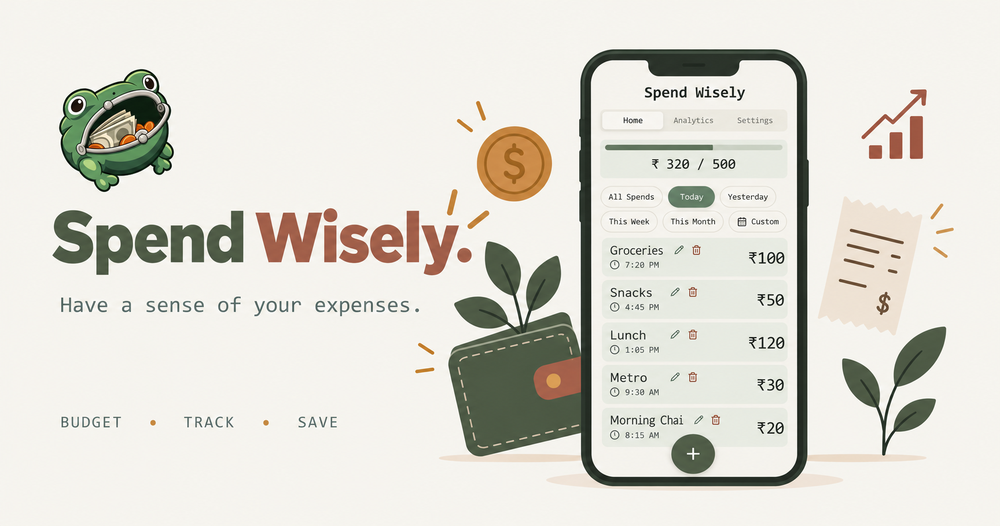

# Spend Wisely

Have a sense of your expenses.

Spend Wisely is a free personal expense tracker and budget tracker you can use right in your browser. Log your daily spending in seconds, see how close you are to your budget, and spot where your money actually goes, all without creating an account. It's also an installable app (PWA), so you can add it to your phone or desktop and use it offline, just like a native app.

## Features

- Log what you spend, in seconds
- See a daily spending progress bar so you always know where you stand
- Get a heads-up before you go over budget, with a configurable warning threshold
- Filter your spending by Today, Yesterday, This Week, This Month, or a custom date range
- Review your spending history at a glance
- Set your own currency, daily budget, and warning threshold
- Light, dark, or system theme
- Install it like a real app on your phone or desktop, with quick shortcuts to Analytics and Settings, works offline, no app store needed

## Built with

Built with React, TypeScript, and Vite, deployed on Cloudflare.

## Your data stays yours

Everything you enter is stored only on your own device. Nothing is sent to a server, and no account is required.

## For developers

Want to run or build this project locally? See [DEVELOPMENT.md](./DEVELOPMENT.md).
